# Real Estate Investment Advisor

**Predicting property profitability and future value** with machine learning, tracked in MLflow and served through a Streamlit app.

    

**Live app:** https://real-estate-investment-advisor-wm9lvyxsixe9zfrpa4arg9.streamlit.app/ | **Data and MLflow database:** [Google Drive folder](https://drive.google.com/drive/folders/1-a0epP92o1qCvBXUQV6qqaloZAC16O_R?usp=sharing)

---

## Overview

The app answers two questions about a property listed in India:

1. **Is it a Good Investment?** (classification, with a confidence score)
2. **What could its price be after 5 years?** (regression)

It is built on 250,000 listings from 20 states and 42 cities, and covers the full data science cycle: cleaning, analysis, statistical tests, feature engineering, model training, experiment tracking, and a deployed web app with market insights.

## Highlights

- Cleaning report with 13 automatic data-quality checks, and 22 EDA questions, each with a written insight
- Statistical tests (correlation, Kruskal-Wallis, ANOVA, chi-square) with effect sizes
- Two XGBoost models, compared with simple baselines, ablation checks and 5-fold cross-validation
- Every experiment tracked in MLflow, and the best models registered
- A four-tab Streamlit app: prediction, property explorer, market insights and model details

## The app

### Predict: is this property a good investment?
Enter a property's details to get a verdict, a confidence score, a 5-year price estimate, a comparison with similar properties and a chart of the factors behind the decision.

<table>
<tr>
<td>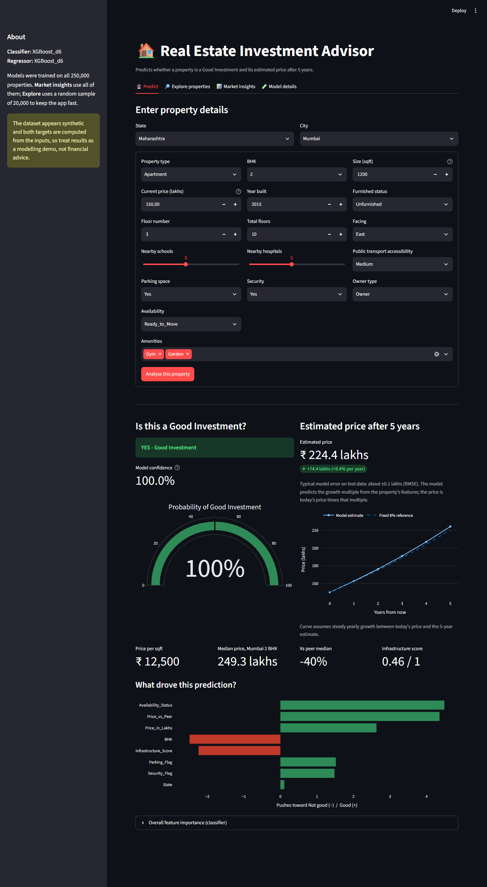</td>
<td>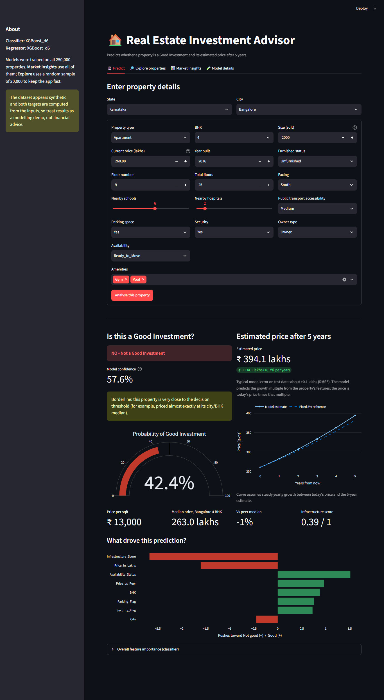</td>
<td>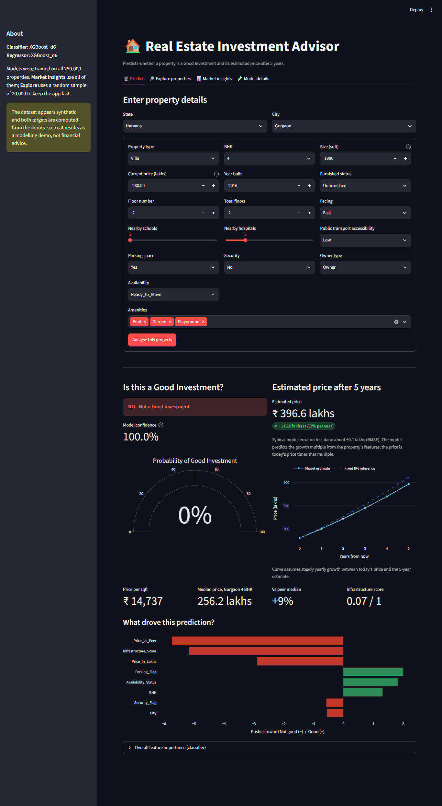</td>
</tr>
<tr>
<td align="center"><b>Good investment</b><br>Mumbai, 2 BHK, 150 lakhs: priced 40% below similar homes. Estimated 224.4 lakhs in 5 years.</td>
<td align="center"><b>Borderline</b><br>Bangalore, 4 BHK, 260 lakhs: priced about 1% below the median, so the model is unsure (57.6% confidence).</td>
<td align="center"><b>Not a good investment</b><br>Gurgaon villa, 280 lakhs: priced 9% above similar homes with low infrastructure.</td>
</tr>
</table>

### Explore properties
Filter by city, property type, BHK, price, area and availability. Every match is scored by both models and can be sorted and downloaded.

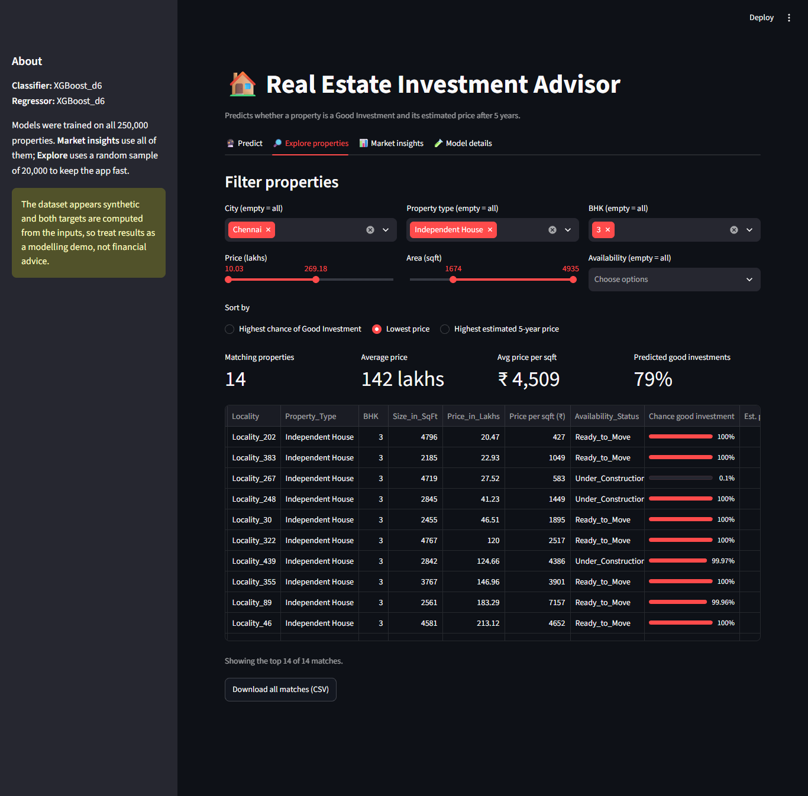

### Market insights
City heatmaps (price per sqft, good-investment rate, 5-year price), price trend by build decade, and state and infrastructure charts, computed from all 250,000 listings.

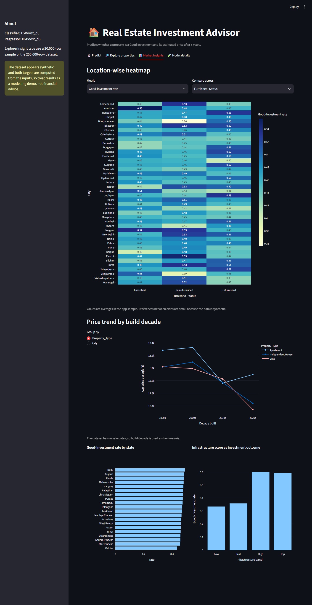

### Model details
Metrics, baselines, ablation checks, cross-validation, confusion matrix and feature importance, so users can see how far to trust a result.

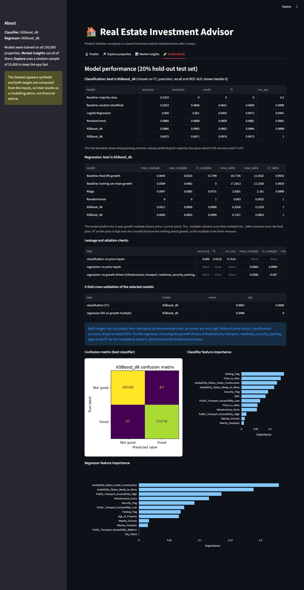

## How the project works

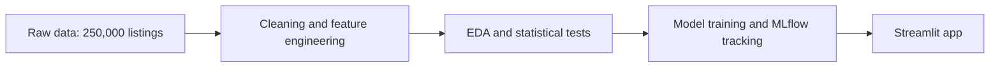

### 1. Data cleaning and features
The raw data has no missing values or duplicates, but the checks found real issues that were fixed:

| Issue | Handling |
|---|---|
| Price per sqft stored in rounded lakhs (2,534 rows showed 0.00) | Recomputed in rupees |
| Floor number above total floors in 46.5% of rows | Flagged, then capped at the top floor |
| 19,723 price-per-sqft outliers (7.9%) | Flagged and kept (valid small, expensive flats) |
| 16,816 rows with under 250 sqft per BHK | Reported and kept |

New features include an infrastructure score, school density, amenity count, parking and security flags, and the price compared with the median of the same city and BHK. Full details: [`docs/preprocessing_report.md`](docs/preprocessing_report.md).

### 2. Exploratory analysis
22 questions with charts and a written insight each: [`docs/eda/eda_insights.md`](docs/eda/eda_insights.md). Significance tests: [`docs/stats_tests.md`](docs/stats_tests.md).

<table>
<tr>
<td>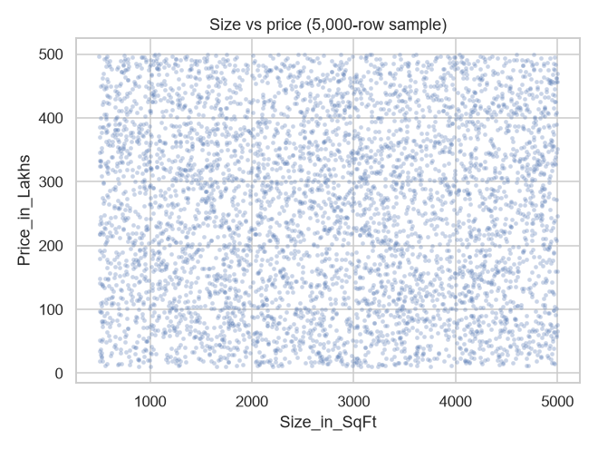</td>
<td>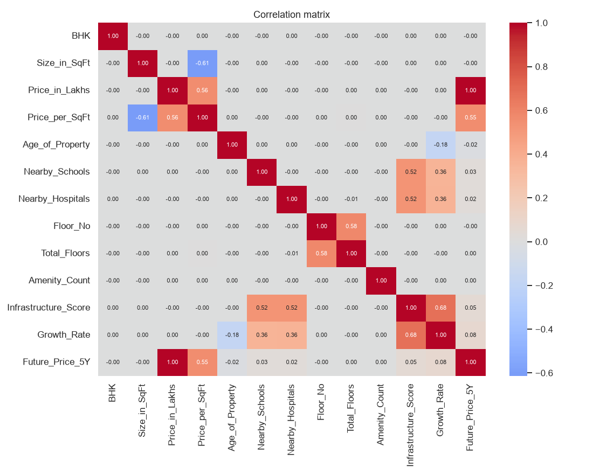</td>
<td>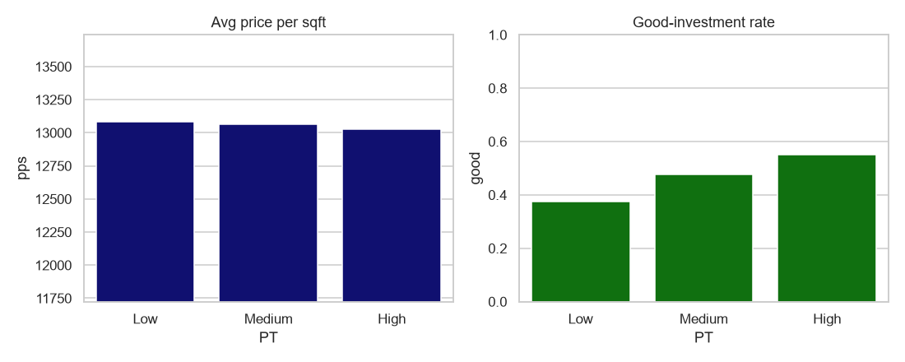</td>
</tr>
<tr>
<td align="center">Size does not explain price (r = -0.003)</td>
<td align="center">Raw features are almost uncorrelated</td>
<td align="center">Better transport goes with more good investments</td>
</tr>
</table>

Main finding: price is unrelated to size, BHK, city and amenities in this dataset, which indicates the data is synthetic. This shaped how the targets and the evaluation were designed.

### 3. Targets
The dataset has no sale history, so both targets use documented rules ([`docs/label_justification.md`](docs/label_justification.md)):

- **Good Investment:** a 6-point score, Good if 4 or more. Price at or below the same-city, same-BHK median (2 points), then 1 point each for 3+ BHK, ready to move, infrastructure at or above the median, and parking or security. About 46.7% of properties are good.
- **Future price:** `price x (1 + r)^5`, where the yearly growth `r` is 5% to 10% depending on infrastructure, readiness, security, parking and building age.

### 4. Models and results
Data split 80/20 (stratified, seed 42). The classifier predicts the label; the regressor predicts the **growth multiple** (future price / current price), and the price after 5 years is the current price times that multiple.

**Classification (50,000 test properties)**

| Model | Accuracy | F1 | ROC-AUC |
|---|---|---|---|
| Baseline: always the majority class | 0.533 | 0.000 | 0.500 |
| Baseline: random guess | 0.502 | 0.466 | 0.500 |
| Logistic Regression | 0.858 | 0.847 | 0.944 |
| Random Forest | 0.989 | 0.988 | 0.999 |
| **XGBoost, depth 6 (selected)** | **0.9975** | **0.9973** | **1.000** |

Selected on F1 (ROC-AUC breaks ties). 5-fold cross-validation F1: 0.9962 +/- 0.0006. With price inputs removed, accuracy falls to 0.649, showing how much of the skill comes from price.

**Regression (growth multiple)**

| Model | R2 on the multiple | RMSE on final price (lakhs) |
|---|---|---|
| Baseline: fixed 8% growth | -0.180 | 18.77 |
| Baseline: average growth | 0.000 | 17.28 |
| Ridge | 0.973 | 2.84 |
| **XGBoost, depth 6 (selected)** | **0.9999** | **0.13** |

With the growth drivers removed (infrastructure, transport, readiness, security, parking, age), R2 falls to -0.007, which shows the model really learns them.

<table>
<tr>
<td>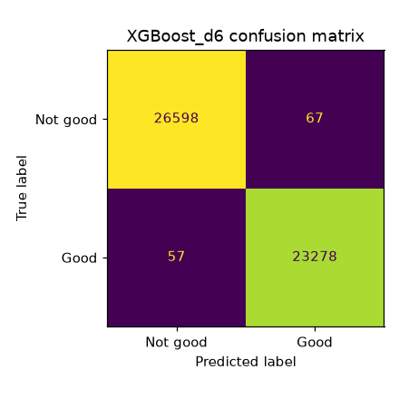</td>
<td>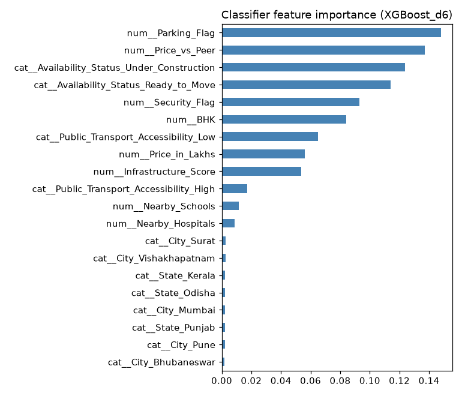</td>
<td>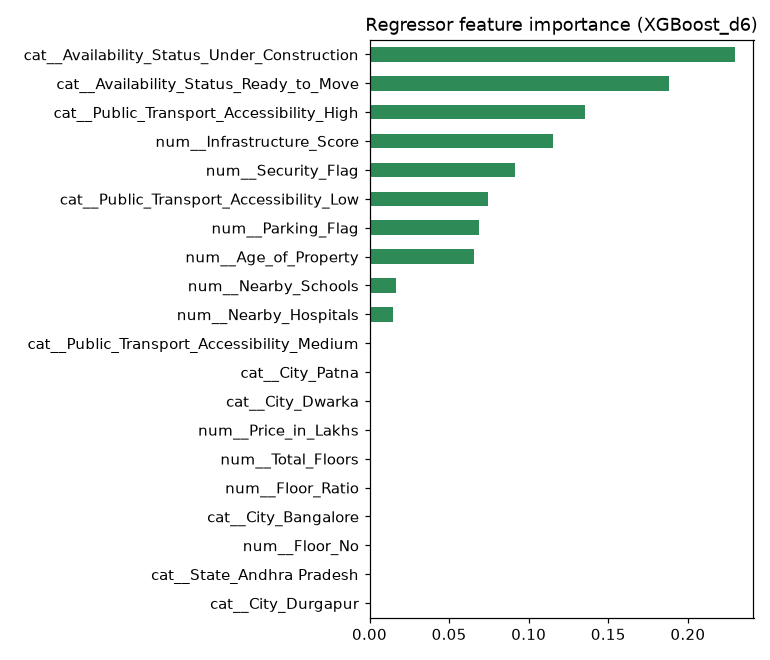</td>
</tr>
<tr>
<td align="center">Confusion matrix (67 false alarms, 57 misses)</td>
<td align="center">Classifier: what drives the label</td>
<td align="center">Regressor: what drives growth</td>
</tr>
</table>

### 5. Experiment tracking with MLflow
Every run logs its parameters, metrics and model; the best models are registered in the model registry. Run `mlflow ui --backend-store-uri sqlite:///mlflow.db` to explore them.

<table>
<tr>
<td>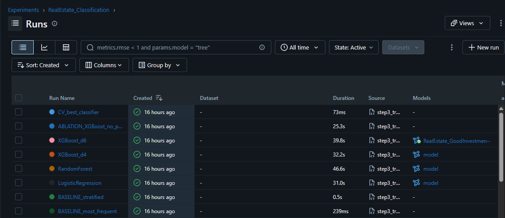</td>
<td>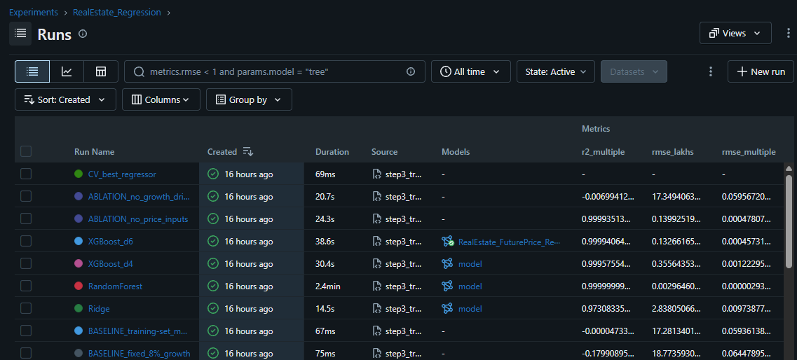</td>
<td>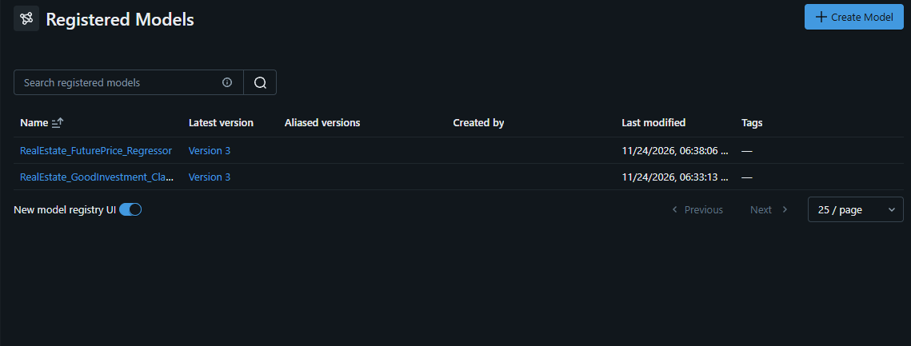</td>
</tr>
<tr>
<td align="center">Classification runs</td>
<td align="center">Regression runs</td>
<td align="center">Registered models</td>
</tr>
</table>

## How the project evolved

Early iterations delivered the complete pipeline. Later iterations tightened the design so the results are easier to trust:

| Area | Before | Now | Why it matters |
|---|---|---|---|
| Regression target | Predicted the 5-year price with the current price as an input | Predicts the growth multiple; price = current price x multiple | The model can no longer score well by copying the price and must learn the growth drivers |
| Evaluation | Linear-model baselines and one fixed 8% growth rule | Adds majority-class and random-guess baselines, a mean-growth baseline, a growth-driver ablation and 5-fold cross-validation | Shows the lift over guessing instead of a bare score |
| Model selection | Best F1 or lowest RMSE, rule not written down | Rule documented: classifier on F1 (ROC-AUC breaks ties) with precision, recall and confusion matrix reported; regressor on RMSE of the multiple | No single metric decides on its own |
| Investment benchmark | Price per sqft against the city median | Price against the same-city, same-BHK median | Price per sqft follows size in this data, so the early rule favoured large properties |
| Label rule | Described | Each criterion justified and other cut-offs tested | The rule and its limits are documented |
| EDA | Charts, numbers and some commentary | A one-line insight for every question | Every result says what it means |
| Preprocessing | Cleaning in code with a printed summary | Automatic report with 13 data-quality checks | Every issue and action is visible |
| Deployment | Any model could be chosen | Models above 25 MB are excluded; deployed models are about 1 MB | Fits GitHub and the cloud app |
| App | Predictions, charts and model scores | Adds the baselines, checks and cross-validation, and explains the confidence score | Users can see how far to trust a result |

## Use cases

- **Individual investors** can screen a property quickly, see how its price compares with similar properties, and get a projected value after five years.
- **Home buyers** can filter listings by city, budget, BHK and area, and rank the matches by predicted investment quality.
- **Real estate companies and agents** can score every new listing in the same way to speed up the first round of investment analysis.
- **Property platforms** can show the reasons behind each prediction (comparison with similar properties and the main drivers), which makes the result easier to trust.
- **Analysts and planners** can use the market insight charts to compare cities, property types and infrastructure levels.

Before real-world use, the models should be retrained on real transaction data with sale dates, so that "Good Investment" is based on observed appreciation instead of a rule.

## Limitations

- The dataset looks synthetic: price is unrelated to size, BHK, location and amenities.
- Both targets are calculated from the inputs by documented rules, so scores are very high by construction. The baselines and ablation checks are there to show where the skill comes from.
- The confidence score shows how clearly a property meets the investment rule, so most results are close to 0% or 100%. Only properties right on a threshold show values like 50-80%. It is not a real-world guarantee.
- There is no sale history, crime or RERA data. The growth rule is an assumption.
- This is a modelling demonstration, not financial advice.

## Repository structure

```
app/                  Streamlit app (app.py) and its requirements
scripts/
  step1_preprocess.py             cleaning, features, targets, preprocessing report
  step1b_label_justification.py   rule justification and sensitivity
  step2_eda.py                    22 EDA questions with charts and insights
  step2b_stats.py                 statistical significance tests
  common.py                       feature code shared by training and the app
  step3_train.py                  training, baselines, checks, MLflow, model registry
  make_app_sample.py              20,000-row sample for the Explore tab
  make_app_aggregates.py          full-data numbers for Market insights
models/               saved classifier, regressor and metrics
docs/                 EDA charts, model results, reports, MLflow and app screenshots
data/                 small files used by the app (large files are on Drive)
```

## Run locally

```bash
pip install -r requirements.txt
python scripts/step1_preprocess.py data/india_housing_prices.csv data docs
python scripts/step1b_label_justification.py data/cleaned_housing.csv docs
python scripts/step2_eda.py data/cleaned_housing.csv docs/eda
python scripts/step2b_stats.py data/cleaned_housing.csv docs
python scripts/step3_train.py data/cleaned_housing.csv models
python scripts/make_app_sample.py data/cleaned_housing.csv data/sample_app.csv
python scripts/make_app_aggregates.py data/cleaned_housing.csv data
streamlit run app/app.py
```

The raw and cleaned datasets are too large for GitHub. Cleaned dataset: [Google Drive](https://drive.google.com/file/d/1N5KKEC3R0nKYjNRDOF8_sWPmEtmVZo_C/view?usp=sharing).

## Tech stack

Python, pandas, NumPy, scikit-learn, XGBoost, SciPy, Plotly, matplotlib, seaborn, MLflow, Streamlit, Git and GitHub.

## Author

**Debojjo Talukdar**
